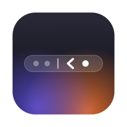
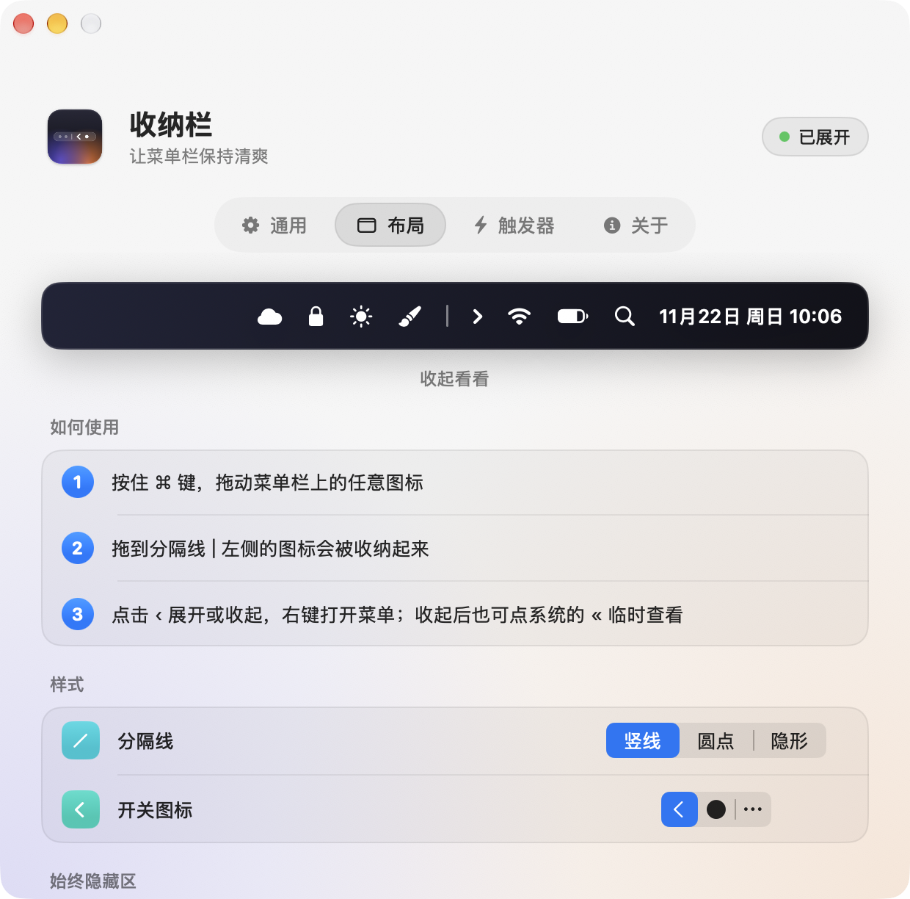
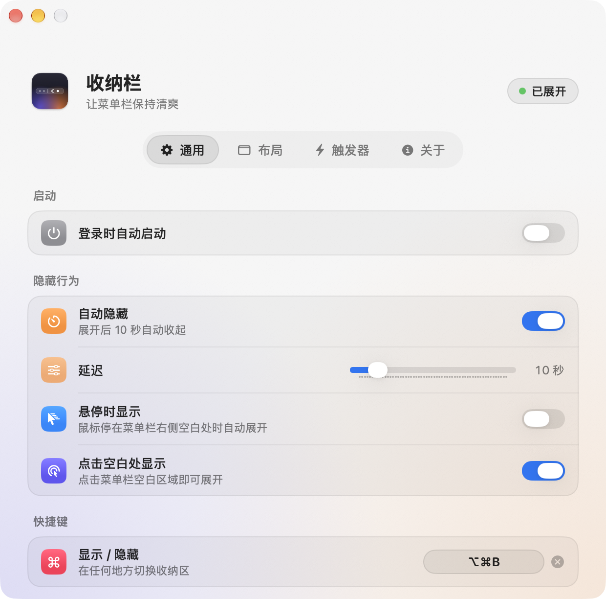
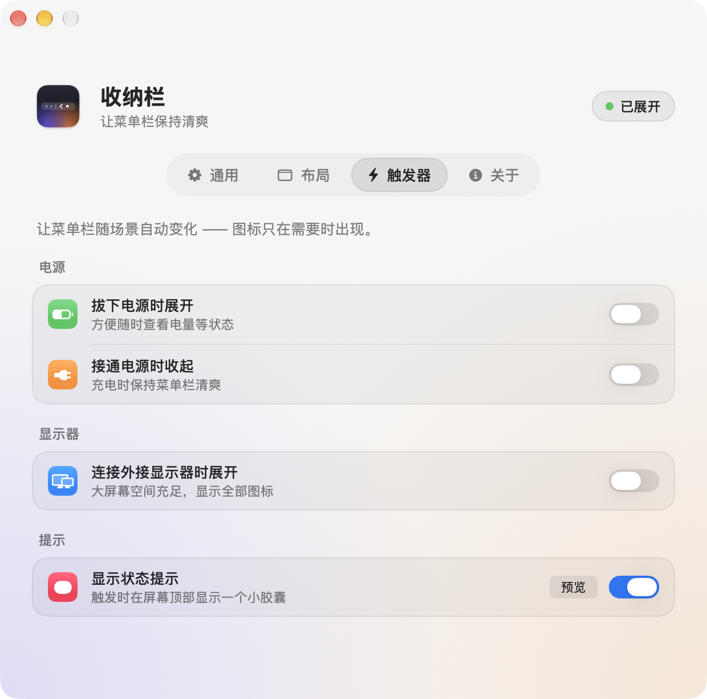
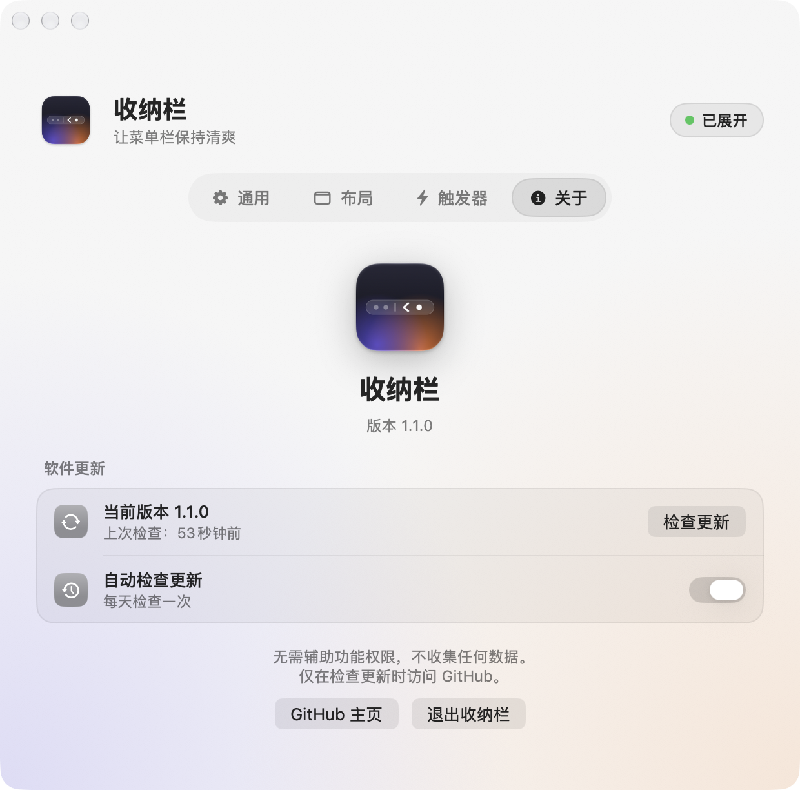

<div align="center">



# 收纳栏 MenuShelf

**让菜单栏保持清爽。**

一个简约、原生的 macOS 菜单栏收纳工具，中文界面，适配 macOS 27。

[](https://github.com/245678000000/MenuShelf/releases/latest)


</div>

---

菜单栏图标越装越多，刘海一挡，重要的反而看不见。收纳栏在菜单栏里放一条分隔线 `│`：线左边的图标平时收起来，需要时一点就出来。

<p align="center">
  
  
</p>

## ✨ 功能

| | |
|---|---|
| 🗂 **一键收纳** | 按住 ⌘ 把图标拖到分隔线左侧，点击 `‹` 即可收起 / 展开 |
| ⌨️ **全局快捷键** | 默认 `⌥⌘B`，可自定义 |
| ⏱ **自动隐藏** | 展开后 3–60 秒自动收起，鼠标还在菜单栏上时不会打扰你 |
| 🖱 **悬停 / 点击空白处展开** | 不用精确去点那个小箭头 |
| ⚡️ **触发器** | 拔下电源时展开、接通电源时收起、连接外接显示器时展开 |
| 💊 **状态提示** | 触发时在屏幕顶部显示一个玻璃质感的小胶囊 |
| 👁 **始终隐藏区** | 再加一条 `┆`，放那些几乎不用、又删不掉的图标 |
| 🎨 **样式** | 分隔线可选竖线 / 圆点 / 隐形，开关图标三种样式，自动适配深浅色 |
| 🔄 **检查更新** | 每天自动检查 GitHub 新版本，一键下载、替换并重启 |
| 🔒 **隐私** | 无需辅助功能权限，不收集任何数据，仅在检查更新时访问 GitHub |

<p align="center">
  
  
</p>

## 📦 安装

1. 从 [Releases](https://github.com/245678000000/MenuShelf/releases/latest) 下载 `MenuShelf-x.y.z.zip`
2. 解压，把 **收纳栏.app** 拖进「应用程序」文件夹
3. 首次打开：App 未经 Apple 公证，macOS 会拦截。请 **右键 → 打开**，或在终端执行：

   ```bash
   xattr -dr com.apple.quarantine /Applications/收纳栏.app
   ```

> 系统要求：macOS 14 Sonoma 及以上，Apple 芯片与 Intel 通用。

### 更新

1.1.0 起内置检查更新：发现新版本时屏幕顶部会出现提示，右键 `‹` 选择「更新到 x.y.z…」，或在「设置 → 关于」里点「下载并安装」，App 会自动替换并重启。也可以在「关于」页关闭自动检查。

## 🚀 使用

首次启动会自动打开设置窗口。菜单栏右侧会出现两个新图标：

```
  [ 被收纳的图标… ]  │  [ 常显图标 ]  ›   控制中心  时间
                     ↑                ↑
                   分隔线            开关
```

1. **按住 ⌘**，把想藏起来的图标拖到 `│` 左边
2. **点击 `‹` / `›`**（或按 `⌥⌘B`）收起、展开
3. **右键**开关图标，打开菜单（设置、退出等）
4. 开启「始终隐藏区」后，**⌥ 点击**开关可以连同始终隐藏的图标一起显示

## ❓ 常见问题

<details>
<summary><b>收起后菜单栏上出现了一个 <code>«</code>，这是什么？</b></summary>

这是 macOS 27 自带的溢出按钮。收纳栏收起时，被收纳的图标会进入这个系统溢出区。点一下 `«` 可以临时查看它们（会盖在左侧的应用菜单上，按钮变成 `»`），再点一次收回。
</details>

<details>
<summary><b>启动后看不到收纳栏的图标？</b></summary>

菜单栏太满时，新图标可能被系统挤进溢出区。可以：
- 点击系统的 `«` 找到它，按住 ⌘ 拖到右侧；
- 或在「系统设置 → 菜单栏」里关掉一些不常用的图标；
- 确认「系统设置 → 菜单栏 → 允许在菜单栏中显示」里收纳栏没有被关闭。
</details>

<details>
<summary><b>点击收起时提示「请把分隔线拖到箭头左侧」？</b></summary>

分隔线 `│` 必须在开关 `‹` 的左边，否则收起时会把开关本身也藏掉。按住 ⌘ 把分隔线拖到开关左侧即可。
</details>

<details>
<summary><b>「登录时自动启动」打不开？</b></summary>

请先把 App 放进「应用程序」文件夹再开启。
</details>

## 🛠 从源码构建

需要 macOS 14+ 和 Xcode Command Line Tools（不需要完整的 Xcode）。

```bash
git clone https://github.com/245678000000/MenuShelf.git
cd MenuShelf
./build.sh                 # 生成 build/收纳栏.app（通用二进制）
open build/收纳栏.app
```

## 🔍 原理

以前的菜单栏管理工具（Bartender、Ice、Hidden Bar 等）都用同一个办法：把自己的一个状态栏项拉到 10000pt 宽，把左边的图标推出屏幕。

**macOS 27 改了菜单栏架构**：整个菜单栏由一个窗口绘制，过宽的状态栏项会被系统直接移除，老办法失效了。

收纳栏的做法是：收起时只把分隔线拉伸到 **刚好填满「刘海右沿 → 分隔线」之间的空间**（没有刘海的屏幕以屏幕中线为界）。分隔线左侧的图标放不下了，系统就会把它们收进自带的 `«` 溢出区；展开时把分隔线缩回原样，图标也就回来了。

整个过程只操作收纳栏**自己的**状态栏项，所以不需要辅助功能或屏幕录制权限。

> ⚠️ 这依赖的是系统的排版行为，并非官方 API，未来的 macOS 更新可能使其失效。

## 📁 项目结构

```
Sources/MenuShelf/
├── main.swift                 # 入口
├── AppDelegate.swift          # 生命周期、触发器、设置窗口
├── StatusBarController.swift  # 核心：分隔线 / 开关 / 收起与展开
├── SettingsView.swift         # SwiftUI 设置界面
├── Prefs.swift                # 用户设置（UserDefaults）
├── Updater.swift              # 检查更新与自动安装（GitHub Releases）
├── HotKey.swift               # 全局快捷键（Carbon）
├── PowerMonitor.swift         # 电源状态监听（IOKit）
└── HUD.swift                  # 顶部胶囊提示
scripts/make_icon.swift        # 生成应用图标
build.sh                       # 构建并打包 .app
```

## 🙏 致谢

交互设计参考了 [Bartender](https://www.macbartender.com)、[Ice](https://github.com/jordanbaird/Ice) 和 [Thaw](https://github.com/thaw-app/Thaw)。
